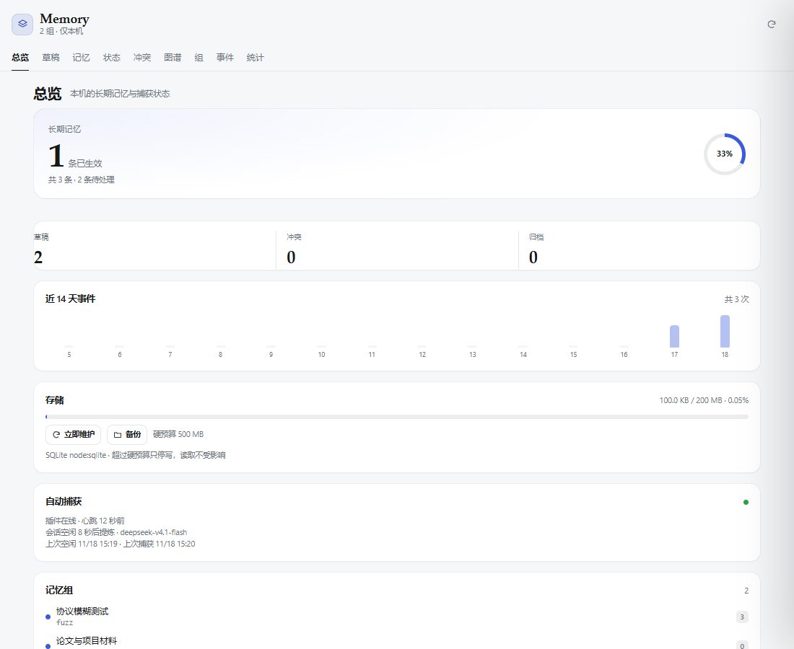
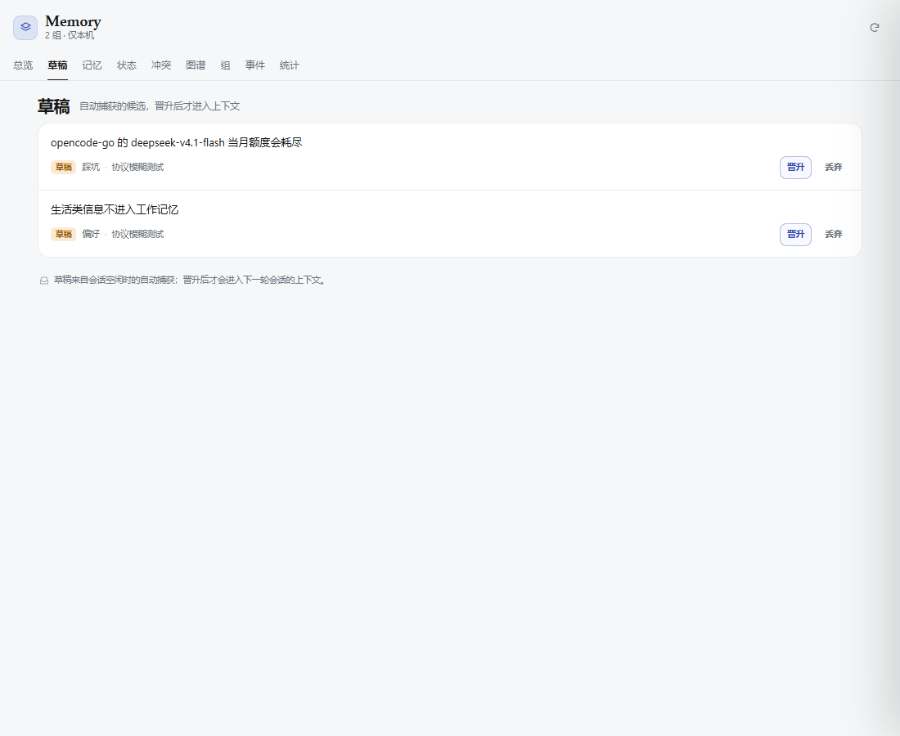
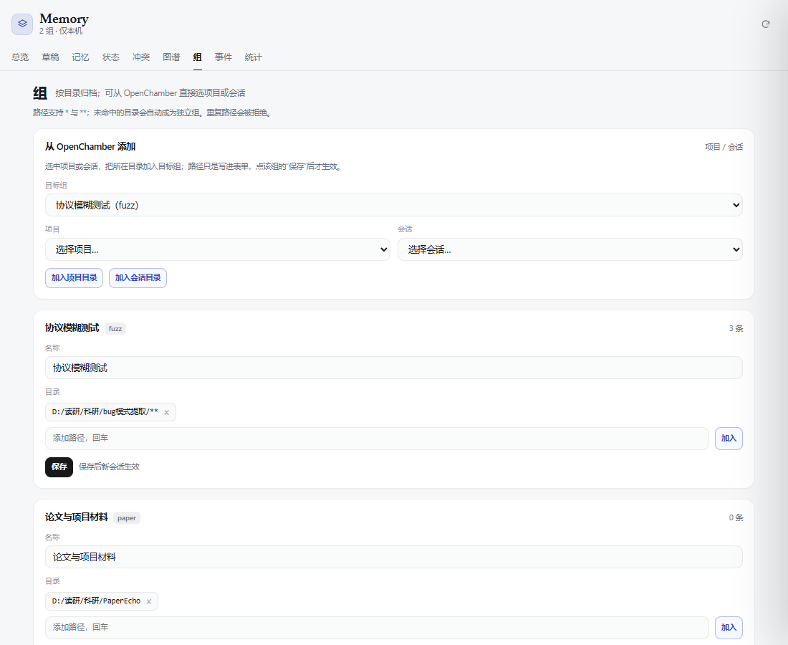
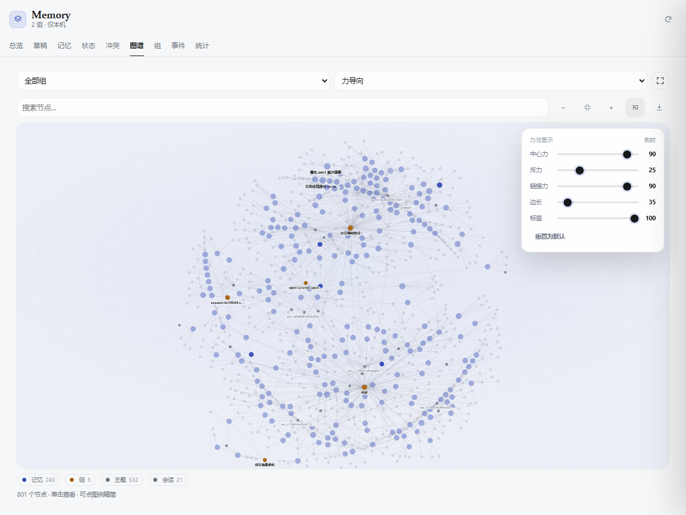
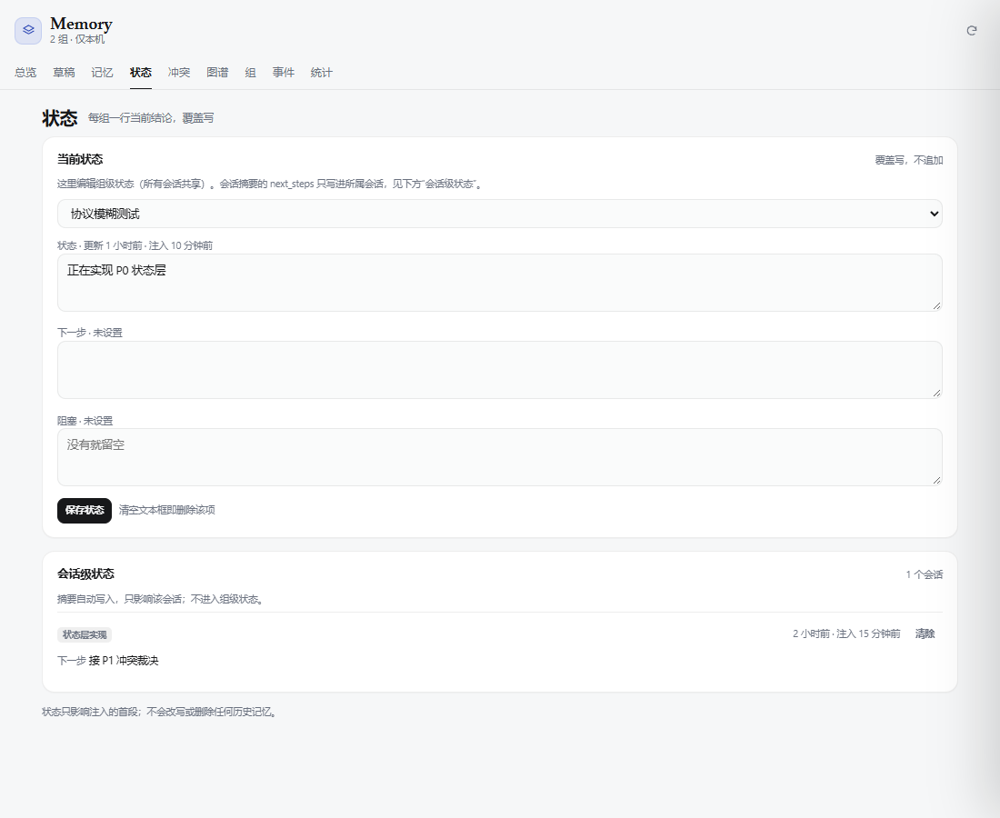
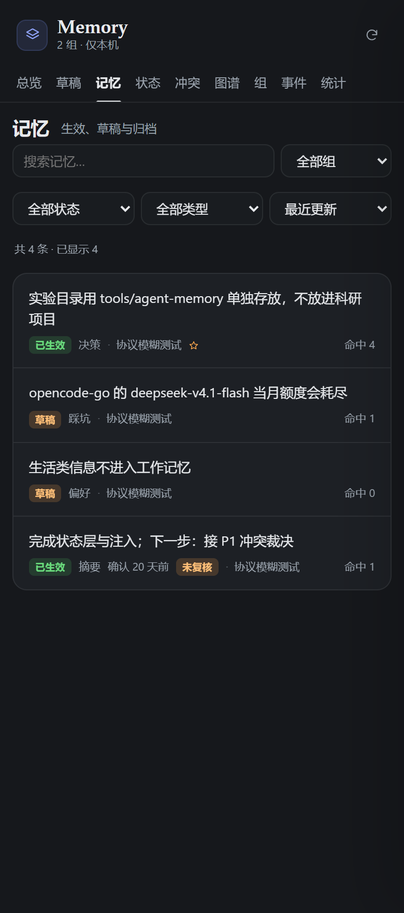

# Agent Memory

Local-first memory for [OpenChamber](https://openchamber.dev) and OpenCode.

Your agent's decisions, pitfalls and per-session state are stored in a single SQLite file on your machine, curated by you, and handed back to the model when it matters. No account, no cloud, no embedding service, no Docker.



## Why

A long session forgets what was decided an hour ago, and a new session starts from zero. Memory fixes that only if three things hold:

1. **It is cheap to keep.** Capture must not cost a model call per message.
2. **It is cheap to trust.** You can see every item and delete it.
3. **It is scoped.** Work memory must not leak into personal memory, and one project must not leak into another.

Agent Memory is built around those three constraints: SQLite + FTS5, a draft queue you promote by hand, and groups that bind paths to scopes.

## What it does

| | |
|---|---|
| **Capture** | The bundled OpenCode plugin reads a finished session, extracts user-stated decisions/pitfalls/decisions, and writes them to a **draft** queue. Drafts never reach the context until promoted. |
| **Promotion** | Promote, edit, pin, demote or forget each item. Drafts expire (`TTL`) instead of piling up. |
| **Scopes** | Group scopes (`fuzz`, `paper`, ...) are path-matched to where you work; session scopes are created per session. Injection prefers the current session, then the group. |
| **State** | A small key/value layer (`next steps`, `blockers`, ...) so a session can pick up where it stopped. Group state is written by hand; session state is written from the session summary. |
| **Conflict resolution** | Near-duplicate candidates are compared by a model once, and the result is `duplicate` / `supersedes` / `unrelated`. A superseded item keeps its history (`valid_to`, `superseded_by`). |
| **Graph** | Entities and relations extracted from promoted memories, drawn as a force-directed graph with neighbour highlighting, search and label culling. |
| **Audit** | Every write is an event. `stats`, `doctor`, backup/restore, and a size budget. |

## Screenshots

| Drafts | Memory list | Graph |
|---|---|---|
|  |  |  |

| Session state | Mobile (390 px) |
|---|---|
|  |  |

The panel UI is currently in Chinese.

## Install

Requirements: **Node.js 22.5+** (for `node:sqlite`), **OpenChamber 2.7+**.

1. Open **Settings → Extensions**, paste this repository URL into the folder / ZIP / URL field and choose **Add**:

   ```
   https://github.com/Xiaoqiang-Huang/openchamber-agent-memory
   ```

2. Allow the permissions it asks for. The panel talks to a local service, which is what reads your memory database.

3. Optional — let chat sessions use the memory. Install the OpenCode plugin from the copy bundled in this package, then restart OpenChamber:

   ```
   node "<extension folder>/core/bin/mem.mjs" install
   ```

   That writes `~/.config/opencode/plugins/agent-memory.js` and a `/mem` command, and records where the CLI lives in `~/.agent-memory/install.json`.

4. Open the **Agent Memory** icon in the sidebar.

Data lives in `~/.agent-memory` (`agent-memory.db`, `config.json`, `groups.json`, `backups/`). Set `AGENT_MEMORY_DIR` to move it.

## How a memory gets used

```
finished session ──▶ plugin extracts ──▶ drafts ──▶ you promote ──▶ memories
                                                                      │
                     session start ◀── injected context ◀── scope match ┘
```

Injection is budgeted (characters, not tokens), prioritises the current session's state, then the group state, then promoted memories ranked by FTS relevance and recency. `last_injected_at` records that an item was offered, not that the model used it.

## CLI

The vendored core in `core/` is a complete CLI, so the panel is not required:

```
node core/bin/mem.mjs doctor            # health, paths, counts
node core/bin/mem.mjs list --group fuzz
node core/bin/mem.mjs context --group fuzz --session <id>
node core/bin/mem.mjs state --group fuzz
node core/bin/mem.mjs backup
node core/bin/mem.mjs serve             # the stand-alone admin UI
```

## Privacy

- No network calls from the extension or the core, except the model call the *plugin* makes to the OpenCode provider you already configured, when summarising a finished session. Disable it with `capture.enabled: false` in `~/.agent-memory/config.json`.
- No telemetry, no remote sync, no embeddings API.
- Uninstalling the extension removes the extension; delete `~/.agent-memory` to remove the data.

## Layout

```
panel/            UI (TypeScript, bundled to panel/main.js)
service/          local HTTP service: panel calls → mem.mjs api
core/             vendored agent-memory 0.5.1 (src/, bin/, plugin/)
assets/           panel icon
docs/screenshots/ README images
DESIGN.md         panel design audit
```

## Development

```bash
bunx openchamber-guest-bundle panel/main.ts panel/main.js
bunx openchamber-guest-bundle service/main.ts service/main.js --node
bunx openchamber-guest-check
```

Installing the folder itself (Settings → Extensions → path) runs the live source, so a panel rebuild only needs the panel reopened.

## License

MIT
